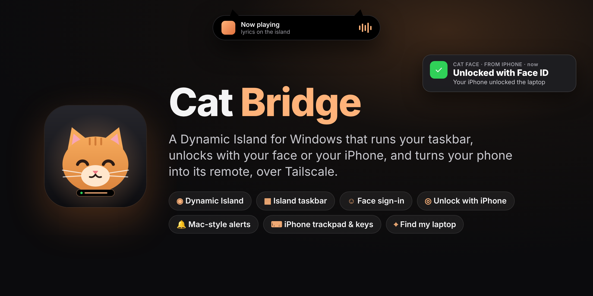

<p align="center">
  
</p>

<p align="center">
  <a href="https://github.com/hamzaibnzakir/cat-bridge/actions/workflows/ios.yml"></a>
  <a href="https://github.com/hamzaibnzakir/cat-bridge/actions/workflows/windows.yml"></a>
  <a href="https://github.com/hamzaibnzakir/cat-bridge/releases/latest"></a>
  
  
  <a href="LICENSE"></a>
</p>

<p align="center">
  <b><a href="docs/SETUP.md">Set-up guide</a></b> ·
  <a href="docs/FEATURES.md">Everything it does</a> ·
  <a href="docs/TROUBLESHOOTING.md">Troubleshooting</a> ·
  <a href="docs/HOW-IT-WORKS.md">How it works</a> ·
  <a href="https://github.com/hamzaibnzakir/cat-bridge/releases/latest">Download</a>
</p>

---

## What is Cat Bridge?

Cat Bridge is two apps that work together.

**On your Windows laptop:** an always-on **Dynamic Island**, the black pill from the iPhone, sitting at the top of your screen with a cat in it.
- **Music:** it shows what's playing with synced lyrics.
- **Notifications:** they drop in like on a Mac.
- **The taskbar:** it can replace the Windows taskbar entirely.
- **Sign-in:** it lets you sign in to Windows with your face, even if your PC has no Windows Hello camera.
- **The desktop cat:** a small cat lives on your taskbar line and keeps you company.
- **Cat Center:** a settings app where you control all of it.

**On your iPhone:** the **Cat Bridge** app connects to your laptop from anywhere in the world through **Tailscale**, a free private network between your own devices.
- **Unlock:** unlock the laptop with Face ID.
- **Remote control:** use your phone as the laptop's trackpad and keyboard.
- **Sharing:** pass files and your clipboard between the two.
- **Find it:** locate the laptop on a map, ring it or wake it up.
- **Notifications:** see your iPhone's notifications on the laptop.

There's no cloud server and no account, and nothing goes through anyone else's computer. Your laptop and phone talk to each other directly and privately.

> Built for a Dell Precision 5540 with no Windows Hello camera. It works on any PC with Windows 10 (version 2004 or later) or Windows 11, and any iPhone with iOS 17 or later.

## ✨ What it does

### On the laptop

| | Feature | What you get |
|---|---|---|
| 🏝️ | **Dynamic Island** | A pill at the top of the screen. It shows album art, **synced lyrics** and an audio visualizer, plus short pop-ups for volume, brightness, charging, Wi-Fi and the camera or mic turning on. Hover to open a **home of widgets**: music, iPhone, system, battery, sound, alerts, timer, shelf, servers. |
| 🧭 | **Island taskbar** | Hide the Windows taskbar and let the island do its job. You get a **dock** of pinned and open apps with **live window previews**, an **app search** (Ctrl + Alt + A), **background apps** with Quit buttons, and an orange glow when an app needs you. |
| 🔔 | **Mac-style notifications** | Banners slide in at the top-right. They pause while you hover, and a two-finger swipe dismisses them. One-time codes get a **Copy code** button. During focus they wait quietly. |
| 🙂 | **Cat Face sign-in** | **Face recognition on the real Windows sign-in screen**, with a "turn your head" check so a photo can't fool it. After two failed tries, it asks for your password. |
| 🐱 | **Desktop cat** | A cat that walks on your taskbar line. It catches dropped files, reminds you to stretch, naps when you're away, and never gets in the way of a click. |
| 🔎 | **Copy text from the screen** | Press **Ctrl + Alt + T** and drag over anything (a video, a picture, a PDF, an app) to copy its text. **Ctrl + Alt + S** takes a screenshot straight onto the shelf. |
| 🎧 | **Pill extras** | **AirPods and Bluetooth battery levels**, **download progress** with speed, camera and mic privacy dots, and a per-app volume mixer. |
| 🎯 | **Focus** | Pomodoro timers that silence notifications and stay in sync with your iPhone's Focus. Includes weekly stats and a streak. |
| 🧰 | **Cat Center** | One app for every setting. The window resizes, nothing overlaps, and two-finger scrolling is smooth. |
| 🔄 | **Installer and updates** | A normal Windows installer, and it **updates itself** from GitHub Releases. |

### On the iPhone

| | Feature | What you get |
|---|---|---|
| 🔓 | **Unlock the laptop with Face ID** | Tap **Unlock laptop** and look at your phone. The laptop unlocks. |
| ☀️ | **Wake the laptop** | Turns its screen on from anywhere. If the laptop is asleep and you're on the same Wi-Fi, it sends a Wake-on-LAN signal. |
| 🖱️ | **Trackpad and keyboard** | Your iPhone becomes the laptop's trackpad: move, click, right-click, scroll and drag. You can type with the iPhone keyboard, and there are keys for copy, paste, switching apps, volume and play. |
| 📍 | **Find my laptop** | See it on a map, make it **ring at full volume**, or switch on **lost mode**, which locks it and shows your message on its screen. |
| 📋 | **Clipboard and files** | Send your clipboard either way, send photos, videos and files to the laptop, and download files from the laptop's shelf. |
| 📤 | **Share sheet** | **Send to Laptop** from Safari, Photos, Files or any app. Links open on the laptop. |
| 🔔 | **Notifications both ways** | Your iPhone's notifications (WhatsApp, Shopify, Mail…) pop up on the laptop. Laptop alerts (low battery, server down, timer done, "Ring my iPhone") arrive on your phone. |
| 🎵 | **Laptop at a glance** | Battery, what's playing (with play, pause and skip), the focus timer, and your focus stats. |
| ⚡ | **Shortcuts actions** | **Send to Laptop**, **Update Laptop**, **Open on Laptop**, **Send File to Laptop**, **Lock Laptop**, **Find My Laptop**, **Start Laptop Focus Timer**. Use them in your own automations. |

👉 **The full guide to every feature, and how to use it, is in [docs/FEATURES.md](docs/FEATURES.md).**

## 🚀 Getting started

The full step-by-step guide, with screenshots-worth of detail, is in **[docs/SETUP.md](docs/SETUP.md)**. In short:

1. **Install on Windows.** Download **DynamicIsland-Setup.exe** from the [latest release](https://github.com/hamzaibnzakir/cat-bridge/releases/latest) and run it. No admin rights needed. If .NET 8 is missing, the installer adds it.
2. **Install Tailscale** on the laptop and the iPhone, and sign in to the same account on both.
3. **Install the iPhone app.** Download **CatBridge.ipa** from the same release and install it with [Sideloadly](https://sideloadly.io) and your Apple ID. No Mac needed.
4. **Pair them.** On the laptop open **Cat Center → iPhone**, press **Allow Tailscale devices**, and scan the QR code with your iPhone camera.
5. **Optional extras:**
   - **Bark:** for alerts on your locked iPhone.
   - **Cat Face:** for face sign-in on the laptop.
   - **Face ID unlock:** set it up in the iPhone app's Settings.
   - **Shortcuts automations:** for your iPhone's notifications on the laptop.

> [!NOTE]
> A sideloaded app with a **free Apple ID** lasts 7 days. Re-install it with Sideloadly (your pairing is kept), or let Sideloadly refresh it automatically over Wi-Fi.

> [!TIP]
> Windows SmartScreen may warn you about the installer because it isn't code-signed yet. Choose **More info → Run anyway**.

## 🔒 Privacy and security, in plain words

- **Your laptop is only reachable from your own devices.** The laptop listens only on its private Tailscale address, never on your Wi-Fi or the internet. A firewall rule allows only Tailscale devices, and every request needs the secret pairing key from the QR code.
- **Your face never leaves the PC.** Cat Face stores 11 sets of numbers describing your face, not photos. They're encrypted with Windows' built-in protection.
- **Face ID unlock can't be faked from the PC.** The unlock key lives in your iPhone's **Secure Enclave** and only works after Face ID. The lock screen checks every unlock itself, against a list only Administrators can change. You approve a new phone on the laptop after checking a 6-digit code.
- **You can't be locked out.** Windows' own password and PIN options always stay available.
- **Phone alerts can be fully encrypted.** Turn on Bark's encryption and only your iPhone can read them.

The details are in [docs/HOW-IT-WORKS.md](docs/HOW-IT-WORKS.md#security).

## ⌨️ Keyboard shortcuts

| Keys | What it does |
|---|---|
| `Ctrl + Alt + Space` | Open or pin the island |
| `Ctrl + Alt + A` | Search and open apps |
| `Ctrl + Alt + C` | Open Cat Center |
| `Ctrl + Alt + T` | Copy text from anything on screen |
| `Ctrl + Alt + S` | Screenshot to the shelf |
| `Ctrl + Alt + H` | Hide or show the island |

## 📚 Documentation

| Guide | What's in it |
|---|---|
| [**SETUP.md**](docs/SETUP.md) | Step-by-step installation and set-up of everything, from zero |
| [**FEATURES.md**](docs/FEATURES.md) | What every feature does and how to use it, on the laptop and the iPhone |
| [**TROUBLESHOOTING.md**](docs/TROUBLESHOOTING.md) | Common problems and fixes, log files, how to uninstall |
| [**HOW-IT-WORKS.md**](docs/HOW-IT-WORKS.md) | Architecture, security model, the bridge API, where data is stored, every setting |
| [**ios/README.md**](ios/README.md) | Building and developing the iPhone app |
| [**CONTRIBUTING.md**](CONTRIBUTING.md) | How to build, test and send changes |
| [**CHANGELOG.md**](CHANGELOG.md) | What changed in each version |

## 📁 Repository layout

```
cat-bridge/
├── windows/                 The Windows app (C# · WPF · .NET 8)
│   ├── Bridge/              Cat Bridge server, Bark alerts, Tailscale helpers
│   ├── Center/              Cat Center (the settings app)
│   ├── Taskbar/             Island taskbar: windows, icons, app search, previews, hiding the taskbar
│   ├── Notify/              Mac-style banners, sign-in summary
│   ├── Cat/                 The cat (drawn in code), the desktop cat
│   ├── FaceId/  FaceHelper/ Face set-up and checking (OpenCV YuNet + SFace)
│   ├── FaceSignIn/          The Windows sign-in tile (credential provider, .NET Framework 4.8)
│   ├── Installer/           Inno Setup installer script and artwork
│   └── build.ps1            Builds the installer and the zip
├── ios/                     The iPhone app (SwiftUI · iOS 17+)
│   ├── CatBridge/           App, screens, Face ID unlock, Shortcuts actions
│   ├── ShareExtension/      "Send to Laptop" in the share sheet
│   └── Packages/CatBridgeCore   Networking + tests (runs on Linux too)
└── docs/                    Guides and images
```

## 🛠️ Build it yourself

| | How | Automatic builds |
|---|---|---|
| Windows | `cd windows && pwsh ./build.ps1` (needs the .NET 8 SDK; [Inno Setup 6](https://jrsoftware.org/isinfo.php) for the installer) | `windows.yml` builds the installer and zip on every push |
| iPhone | `cd ios && xcodegen generate && open CatBridge.xcodeproj` (needs a Mac with Xcode 16) | `ios.yml` builds an unsigned `.ipa` on GitHub's Macs. No Mac needed. |
| Core tests | `cd ios/Packages/CatBridgeCore && swift test` | Runs on Linux in CI |

**To publish a version,** run **Actions → Release → Run workflow** and type the version (for example `v2.3.0`). It builds everything and creates the GitHub Release, and the Windows app's auto-updater picks it up.

## 🗺️ Roadmap
- [ ] Real screenshots and a short demo video
- [ ] iPhone Home Screen and Lock Screen widgets (laptop battery, focus today)
- [ ] Recipe for a self-hosted Bark server on a VPS over Tailscale
- [ ] Code-signed installer and a winget listing

## 🤝 Contributing
Issues and pull requests are welcome. Read [CONTRIBUTING.md](CONTRIBUTING.md) first. Please report security problems privately, as described in [SECURITY.md](SECURITY.md).

## 🙏 Credits
- **Face recognition:** [YuNet](https://github.com/opencv/opencv_zoo/tree/main/models/face_detection_yunet) (MIT) and [SFace](https://github.com/opencv/opencv_zoo/tree/main/models/face_recognition_sface) (Apache 2.0) from the OpenCV model zoo, via [OpenCvSharp](https://github.com/shimat/opencvsharp).
- **Lyrics:** [LRCLIB](https://lrclib.net).
- **iPhone alerts:** [Bark](https://github.com/Finb/Bark).
- **Private network:** [Tailscale](https://tailscale.com).
- **Libraries:**
  - Sign-in tile interop from [CredProvider.NET](https://github.com/SteveSyfuhs/CredProvider.NET).
  - Audio by [NAudio](https://github.com/naudio/NAudio).
  - QR codes by [QRCoder](https://github.com/codebude/QRCoder).
  - Installer by [Inno Setup](https://jrsoftware.org/isinfo.php).
- **Inspiration:** the volume mixer, notifications and gestures were inspired by [PILLAR](https://github.com/warpirate/pillar-dynamic-island-for-windows) (MIT).

## 👤 Author
Created and maintained by **[@hamzaibnzakir](https://github.com/hamzaibnzakir)**. Released under the [MIT License](LICENSE).
