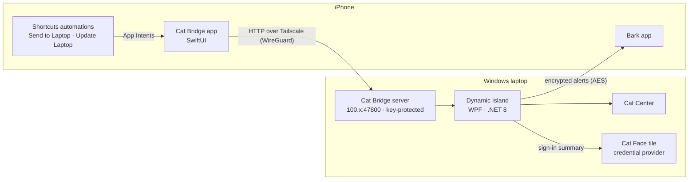

<p align="center">
  
</p>

<p align="center">
  <a href="https://github.com/hamzaibnzakir/cat-bridge/actions/workflows/ios.yml"></a>
  <a href="https://github.com/hamzaibnzakir/cat-bridge/actions/workflows/windows.yml"></a>
  <a href="https://github.com/hamzaibnzakir/cat-bridge/releases/latest"></a>
  
  
  <a href="LICENSE"></a>
</p>

<p align="center">
  <a href="#-whats-inside">What's inside</a> ·
  <a href="#-quick-start">Quick start</a> ·
  <a href="#-how-it-works">How it works</a> ·
  <a href="docs/WINDOWS.md">Full Windows guide</a> ·
  <a href="ios/README.md">iPhone app</a> ·
  <a href="CONTRIBUTING.md">Contributing</a>
</p>

---

**Cat Bridge** turns a Windows laptop into something that feels like a Mac and an iPhone had a kitten.

- **The island:** an always-on Dynamic Island sits at the top of the screen.
- **The taskbar:** the island can replace the Windows taskbar entirely.
- **Sign-in:** a cat-themed face sign-in works on the real Windows lock screen.
- **The iPhone app:** a native app links your phone and laptop anywhere in the world over **Tailscale**. It uses no cloud server and no account.

Built for a Dell Precision 5540 with no Windows Hello camera; it runs on any Windows 10 (2004+) or 11 PC.

## ✨ What's inside

| | Feature | Highlights |
|---|---|---|
| 🏝️ | **Dynamic Island** | Album art, **synced lyrics**, audio visualizer, widget home (system, battery, sound, timer, shelf, servers…), live pop-ups, cat ears that twitch |
| 🧭 | **Island taskbar** | Hide the Windows taskbar; a dock of pinned and running apps with **live window previews**, an app launcher with search (Store apps too), background apps with Quit, "needs attention" glow |
| 🔔 | **Mac-style notifications** | Banners that drop in at the top-right, pause on hover, swipe away with two fingers; **Copy code** for one-time codes; quiet during focus |
| 🐱 | **Desktop cat** | A cat that walks on your taskbar line, catches dropped files, reminds you to stretch and never blocks a click |
| 🙂 | **Cat Face sign-in** | Face recognition with a head-turn liveness check on the real Windows sign-in screen; two failed tries fall back to your password |
| 🔓 | **Unlock with your iPhone** | Face ID on the iPhone unlocks the laptop. The key lives in the iPhone's Secure Enclave, and the lock screen checks the signature itself |
| 🖱️ | **iPhone trackpad and keyboard** | One finger moves, tap to click, two fingers scroll and right-click, hold to drag; type with the iPhone keyboard, plus shortcut keys |
| 📍 | **Find my laptop** | Map location, a loud alarm, and lost mode with your message on screen and on the sign-in tile |
| ☀️ | **Wake from the iPhone** | Turns the screen on from anywhere over Tailscale; Wake-on-LAN on the same Wi-Fi; optional "stay reachable while plugged in" |
| 📱 | **Cat Bridge for iPhone** | Native SwiftUI app: clipboard both ways, photos and files, a **Send to Laptop share sheet**, music, laptop notifications, **Shortcuts actions** |
| 🎯 | **One focus for both** | Your iPhone's Focus quiets the laptop; the laptop's focus taps your iPhone; Pomodoro and weekly stats |
| 🔎 | **Copy text from the screen** | Ctrl + Alt + T, drag over anything (a video, a picture, a PDF) and its text is copied. Screenshots go to the shelf |
| 🎧 | **Pill extras** | AirPods and Bluetooth battery levels, download progress with speed, and a pop-up when downloads finish |
| 🧰 | **Cat Center** | A desktop app for every setting, with responsive layout and smooth two-finger scrolling |

## 🚀 Quick start

### Windows
1. Download **DynamicIsland-Setup.exe** from the [latest release](https://github.com/hamzaibnzakir/cat-bridge/releases/latest) and run it. No admin prompt is needed; if .NET 8 is missing, the installer gets it for you.
2. Open **Cat Center** from the Start menu (or press **Ctrl + Alt + C**).
3. Updates arrive by themselves: Cat Center → General → Updates.

> [!TIP]
> Windows SmartScreen may warn about an unrecognised app, because the installer isn't code-signed yet. Choose **More info → Run anyway**. Prefer no installer? Use **DynamicIsland-windows.zip** instead.

### iPhone (no Mac needed)
1. Install [Tailscale](https://tailscale.com/download) on the iPhone and the laptop, signed in to the same account.
2. Download **CatBridge.ipa** from the [latest release](https://github.com/hamzaibnzakir/cat-bridge/releases/latest). Install it with [Sideloadly](https://sideloadly.io) using your Apple ID.
3. On the laptop: **Cat Center → iPhone → Allow Tailscale devices**. Then scan the QR code with the iPhone camera.

> [!NOTE]
> With a free Apple ID, sideloaded apps last 7 days. Re-install from Sideloadly (your pairing is kept), or let it auto-refresh over Wi-Fi.

## 🔧 How it works



- **Private by design:** the laptop listens only on its Tailscale address and `127.0.0.1`, never on Wi-Fi or the internet. A firewall rule accepts only Tailscale addresses, and every request needs the pairing key from the QR code.
- **Alerts to a locked iPhone** go through the free [Bark](https://github.com/Finb/Bark) app, because a sideloaded app can't receive push without a paid developer account. Turn on Bark's AES encryption so only your phone can read them.
- **Face data** never leaves the PC: 11 face embeddings, DPAPI-encrypted, readable only by you, Administrators and SYSTEM.
- **iPhone unlock** uses a P-256 key in the iPhone's Secure Enclave that only signs after Face ID. You approve it on the laptop after checking a 6-digit code. The trusted key goes in a file only Administrators can change, and the sign-in tile checks each one-time challenge itself, so a program on the PC can't fake an unlock.

## 📁 Repository layout

```
cat-bridge/
├── windows/                 Dynamic Island, Cat Center, desktop cat, Cat Face sign-in (C# · WPF · .NET 8)
│   ├── Bridge/              Cat Bridge HTTP server, Bark, Web Push, Tailscale helpers
│   ├── Center/              Cat Center desktop app
│   ├── Taskbar/             Island taskbar: windows, icons, launcher, previews
│   ├── Notify/              Mac-style banners, sign-in summary
│   ├── FaceId/  FaceHelper/ Face enrolment and verification (OpenCV YuNet + SFace)
│   ├── FaceSignIn/          Windows credential provider (.NET Framework 4.8 COM)
│   └── build.ps1            Builds windows/dist/DynamicIsland-windows.zip
├── ios/                     Cat Bridge for iPhone (SwiftUI · iOS 17+ · XcodeGen)
│   ├── CatBridge/           App, screens, App Intents
│   └── Packages/CatBridgeCore  Networking client + tests (runs on Linux too)
└── docs/                    Full Windows guide, images
```

## 🛠️ Build from source

| | Command | CI |
|---|---|---|
| Windows | `cd windows && pwsh ./build.ps1` (needs [Inno Setup 6](https://jrsoftware.org/isinfo.php) for the installer) | `windows.yml` builds the installer and zip on every push |
| iPhone | `cd ios && xcodegen generate && open CatBridge.xcodeproj` | `ios.yml` builds an unsigned `.ipa` on GitHub's Macs |
| Core tests | `cd ios/Packages/CatBridgeCore && swift test` | Runs on Linux in CI |

To publish a version, run **Actions → Release → Run workflow** (or push a `v*` tag). It builds the installer, the zip and the iPhone app, and puts them on GitHub Releases, where the app's auto-updater finds them.

## ⌨️ Shortcuts

| Keys | Action |
|---|---|
| `Ctrl + Alt + Space` | Open / pin the island |
| `Ctrl + Alt + A` | Search and open apps |
| `Ctrl + Alt + C` | Cat Center |
| `Ctrl + Alt + H` | Hide / show the island |
| `Ctrl + Alt + T` | Copy text from anything on screen |
| `Ctrl + Alt + S` | Screenshot to the shelf |

## 🗺️ Roadmap
- [ ] Real screenshots and a short demo video
- [ ] iPhone home-screen widget (laptop battery, focus today)
- [ ] Self-hosted Bark server recipe for a VPS over Tailscale
- [ ] Optional Windows 11 lock-screen widget (needs MSIX packaging)

## 🤝 Contributing
Issues and pull requests are welcome. Please read [CONTRIBUTING.md](CONTRIBUTING.md) first. For security reports, see [SECURITY.md](SECURITY.md).

## 🙏 Credits
- **Face models:** [YuNet](https://github.com/opencv/opencv_zoo/tree/main/models/face_detection_yunet) (MIT) and [SFace](https://github.com/opencv/opencv_zoo/tree/main/models/face_recognition_sface) (Apache 2.0), with [OpenCvSharp](https://github.com/shimat/opencvsharp).
- **Lyrics:** [LRCLIB](https://lrclib.net).
- **Phone alerts:** [Bark](https://github.com/Finb/Bark).
- **Other code:** credential provider interop from [CredProvider.NET](https://github.com/SteveSyfuhs/CredProvider.NET). Audio by [NAudio](https://github.com/naudio/NAudio), QR codes by [QRCoder](https://github.com/codebude/QRCoder).
- **Inspiration:** the per-app mixer, notification listener and gestures were inspired by [PILLAR](https://github.com/warpirate/pillar-dynamic-island-for-windows) (MIT).

## 👤 Author
Created and maintained by **[@hamzaibnzakir](https://github.com/hamzaibnzakir)**.

Released under the [MIT License](LICENSE).
