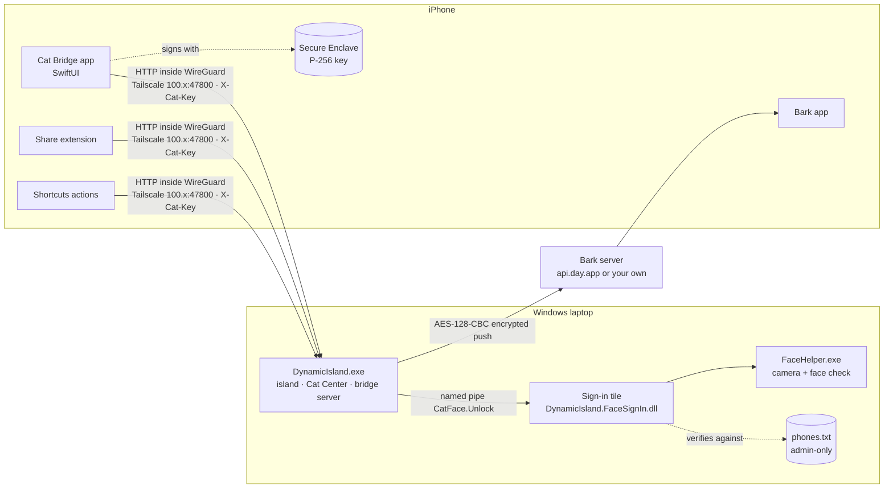

# How it works

The technical side of Cat Bridge: how the pieces fit, how it stays secure, the bridge API, where data is kept, and every setting. You don't need any of this to use it; see [SETUP.md](SETUP.md) and [FEATURES.md](FEATURES.md) for that.

- [Architecture](#architecture)
- [Security](#security)
- [The bridge API](#the-bridge-api)
- [Where data is stored](#where-data-is-stored)
- [Settings reference](#settings-reference)
- [Where the data comes from](#where-the-data-comes-from)

---

## Architecture



### Windows: `windows/`
- **DynamicIsland.exe** is a WPF app on .NET 8, targeting Windows 10 2004 or later for its WinRT APIs. One process runs:
  - the island window
  - the desktop cat
  - Cat Center
  - the taskbar replacement
  - the banners
  - the bridge server
  - the updater

  It runs as you, never as administrator.
- **The sign-in tile** (`FaceSignIn/`) is a Windows *credential provider*: a COM DLL on .NET Framework 4.8 that Windows' LogonUI loads on the lock and sign-in screens. It runs as SYSTEM, so it's installed to `C:\Program Files\DynamicIsland\FaceSignIn` where only administrators can change it.
- **FaceHelper.exe** (`FaceHelper/`) does the camera work for the tile in a separate process. If it crashes, the sign-in screen keeps working. It also performs the few admin-only jobs, such as installing the tile and trusting a phone, behind a UAC prompt.
- **Face recognition** uses OpenCV's **YuNet** detector and **SFace** recogniser (via OpenCvSharp). It compares 128-number face embeddings by cosine similarity.
- **The installer** is an Inno Setup script (`Installer/`). It installs per user without admin rights, and adds the .NET 8 Desktop Runtime if it's missing.

### iPhone: `ios/`
- **CatBridge** is a SwiftUI app for iOS 17 or later, generated with XcodeGen. It has five tabs, App Intents for Shortcuts, and Face ID unlock using a Secure Enclave key.
- **ShareExtension** adds **Send to Laptop** to the share sheet.
- **CatBridgeCore** is a Swift package with the networking, models and pairing. It's shared by the app, the extension and the intents, and it's unit-tested on Linux.
- The pairing (address, port, key) is kept in a **shared Keychain group**, so the extension and Shortcuts never ask for it.

### Builds: `.github/workflows/`
| Workflow | What it does |
|---|---|
| `windows.yml` | Builds the app, the sign-in tile and the installer on a Windows runner. Uploads `DynamicIsland-Setup.exe` and `DynamicIsland-windows.zip`. |
| `ios.yml` | Builds an unsigned `CatBridge.ipa` on a macOS runner, and runs the core tests on Linux. |
| `release.yml` | Run by hand with a version number. Builds both and publishes a GitHub Release. The Windows updater reads the release's assets and their SHA-256 digests. |

---

## Security

### Who can reach the laptop
- The bridge server listens only on **127.0.0.1** and the laptop's **Tailscale addresses** (100.64.0.0/10 and fd7a:115c:a1e0::/48). It never listens on the Wi-Fi or Ethernet address.
- The firewall rule **Dynamic Island Cat Bridge** allows TCP 47800 only from those Tailscale ranges.
- Tailscale encrypts all traffic between devices with **WireGuard**, and only devices signed in to your tailnet can connect. That's why the bridge itself speaks plain HTTP: it never leaves the encrypted tunnel.
- Every `/api/` request must carry the **pairing key**, a long random secret, in the `X-Cat-Key` header (or `?k=`). It's compared in constant time. **New key** in Cat Center replaces it and unpairs every phone.
- **Screen viewing** uses the same paired, Tailscale-only connection. The laptop always shows a purple dot while it's being watched, and Cat Center can turn it off.
- Uploads are capped at 4 GB, and file names are cleaned so nothing can be written outside `Downloads\Cat Bridge`.

### Face ID unlock
1. **Registration.** The iPhone makes a **P-256 key in its Secure Enclave** with the *biometry current set* access control. The private key can't leave the chip and only signs after Face ID. The phone sends its public key to the laptop.
2. **Approval.** Cat Center shows the request with a **6-digit code** computed from a SHA-256 hash of the public key; the iPhone shows the same code, so you can tell a stranger's request from yours. When you press **Allow**, FaceHelper writes the key to `C:\ProgramData\DynamicIsland\FaceSignIn\phones.txt` behind a UAC prompt.
3. **Unlocking.** The sign-in tile creates a random **nonce** that's valid for 60 seconds. The iPhone signs `catbridge-unlock|v1|<MACHINE NAME>|<nonce>` after Face ID. The signature travels through the island app to the tile over a named pipe, `CatFace.Unlock`. The pipe's ACL allows only the signed-in user and SYSTEM.
4. **Checking.** The **tile verifies the signature itself** (ECDSA P-256, SHA-256) against `phones.txt`. Before reading the file, it checks that the owner is Administrators or SYSTEM and that no non-admin account can write to it. Otherwise it ignores the file. So neither the island app nor a standard user can fake an unlock or plant a key.
5. A signature only works once, only for this machine, and only within the 60 seconds.

### Cat Face
- **Templates:** 11 face embeddings, not photos, encrypted with **DPAPI** in `C:\ProgramData\DynamicIsland\FaceId`. They can be read only by you, Administrators and SYSTEM.
- **Your Windows password:** verified with `LogonUser` first, then encrypted with machine-scope DPAPI in `cred.bin`, which only SYSTEM and Administrators can open. The tile releases it to Windows only after the face check and the liveness check pass.
- **Liveness:** a random left or right head turn, then back to the centre with a second identity check.
- **Limits:** a normal RGB webcam can't match Windows Hello's infrared anti-spoofing. A good video or mask could pass. Keep a strong password.
- Windows' own PIN and password providers are never hidden or changed.

### Bark alerts
With encryption on, each alert's JSON is encrypted with **AES-128-CBC** (PKCS7 padding) using your key and IV before it leaves the laptop. The Bark server only relays ciphertext. Without encryption it can read the text, so it's best kept on.

### Updates
The updater reads `releases/latest` from the GitHub API, downloads the installer asset, and checks its **SHA-256** against the `digest` GitHub publishes for that asset before running it.

### Reporting problems
Please report vulnerabilities privately; see [SECURITY.md](../SECURITY.md).

---

## The bridge API

`http://<tailscale-ip>:47800`. Every `/api/` route needs the `X-Cat-Key` header (or `?k=<key>`). JSON in and out unless noted. Without a valid key you get `401`.

### Status and information
| Method | Path | What it does |
|---|---|---|
| GET | `/api/hello` | Laptop name, app version, Tailscale address, port and feature list. The app's connection check |
| GET | `/api/status` | Laptop name, battery and charging, now playing, focus time left, Shelf count |
| GET | `/api/netinfo` | Network adapters with their MAC, local and broadcast addresses (the iPhone keeps these for Wake-on-LAN) |
| GET | `/api/locate` | Latitude, longitude, accuracy, time (needs Windows Location) |
| GET | `/api/focus/stats` | Today, this week, streak |
| GET | `/api/alerts` | The laptop's recent notifications |
| GET | `/api/inbox` | What the laptop sent to the phone |

### Actions
| Method | Path | Body or query | What it does |
|---|---|---|---|
| POST | `/api/ping` | | The cat meows |
| POST | `/api/media` | `?a=toggle\|next\|prev` | Media control |
| POST | `/api/focus` | `?m=25` (`0` stops) | Start or stop a focus timer |
| POST | `/api/lock` | | Lock Windows |
| POST | `/api/wake` | | Turn the screen on |
| POST | `/api/alarm` | `?on=1\|0` | Loud alarm on or off |
| POST | `/api/lost` | `{ "on": true, "message": "…" }` | Lost mode |
| POST | `/api/notify` | `{ "app", "title", "subtitle", "body" }` | Show a banner (Send to Laptop) |
| POST | `/api/phone` | `{ "battery", "charging", "focus" }` | iPhone state (Update Laptop) |
| POST | `/api/link` | `{ "url" }` | Open a link in the default browser |

### Clipboard and files
| Method | Path | What it does |
|---|---|---|
| GET / POST | `/api/clipboard` | Read the laptop's clipboard text / set it (`{ "text" }`) |
| POST | `/api/files` | Upload a file. Raw body, name in the `X-File-Name` header. Saved to `Downloads\Cat Bridge` and the Shelf |
| GET | `/api/shelf` | List the Shelf |
| GET | `/api/shelf/file?i=<n>` | Download item *n* |

### Unlock
| Method | Path | What it does |
|---|---|---|
| POST | `/api/unlock/register` | `{ "name", "publicKey" }`: ask to trust this phone (shown in Cat Center) |
| GET | `/api/unlock/register?key=<id>` | Has that phone been approved yet? |
| GET | `/api/unlock/challenge` | Get a nonce and the machine name from the lock-screen tile |
| POST | `/api/unlock/approve` | `{ "nonce", "signature" }`: pass a signed challenge to the tile |

### Push (web)
`GET /api/push/key`, `POST /api/push/subscribe`, `POST /api/push/test`: Web Push for browsers (an older web version of the app; the native app uses Bark).

### Trackpad and keyboard: `GET /api/input` (WebSocket)
Upgrade to a WebSocket with the key in `?k=`. The server first sends `hi <NAME> <screen width> <screen height>`. Then send one text command per message:

| Command | Meaning |
|---|---|
| `m <dx> <dy>` | Move the pointer by pixels |
| `c l\|r\|m` | Click left, right or middle |
| `d l` / `u l` | Button down / up (for dragging) |
| `dc` | Double-click |
| `s <dy> <dx>` | Scroll |
| `t <text>` | Type text (Unicode) |
| `k <name>` | Press a key: `esc tab enter backspace left up down right win f1–f12 volup voldown playpause …` |
| `h <combo>` | A shortcut, for example `h ctrl+c`, `h alt+tab`, `h win+d` |
| `z in\|out` | Zoom (Ctrl + plus or minus) |
| `a <x> <y>` | Put the pointer at a spot on the main screen, 0–1 across and down (tapping the live screen sends this, then `c l`) |
| `ping` | Keep-alive |

Input is injected with Windows `SendInput`. Windows doesn't allow it on the secure desktop (the lock screen, UAC prompts) or into elevated apps.

### Live screen: `GET /api/screen` (WebSocket)
Upgrade with the key in `?k=`. The phone **pulls** frames, so a slow connection never builds up a backlog.

| Direction | Message | Meaning |
|---|---|---|
| laptop → phone | `screen <W> <H>` | The main screen's size in real pixels. Sent first, and again if the resolution changes |
| laptop → phone | *binary* | One JPEG frame, with the pointer drawn in |
| laptop → phone | `locked` / `unlocked` | Windows was locked or unlocked. No frames are sent while it's locked |
| laptop → phone | `off <reason>` | Screen viewing is turned off on the laptop. The socket then closes |
| phone → laptop | `next` | Allow one more frame (at most 3 waiting). The app keeps two in flight |
| phone → laptop | `q <maxWidth> <quality> <fps>` | Picture width in pixels (320–3840), JPEG quality (20–95), frame-rate cap (1–30) |

- Frames are captured with GDI (`StretchBlt` with HALFTONE scaling and `CAPTUREBLT`, so layered windows such as the island show).
- A frame is only sent when the picture changed, so a still screen costs almost nothing.
- While anyone is watching, the island shows a purple dot. It shows even if privacy dots are turned off.
- Turning off `screenShare` refuses new viewers and closes open ones.

**Example:**
```bash
curl -H "X-Cat-Key: $KEY" http://100.x.y.z:47800/api/status
curl -X POST -H "X-Cat-Key: $KEY" -H "Content-Type: application/json" \
     -d '{"app":"Test","title":"Hello","body":"From curl"}' http://100.x.y.z:47800/api/notify
```

---

## Where data is stored

| What | Where | Who can read it |
|---|---|---|
| The app (installer version) | `%LocalAppData%\Programs\Cat Bridge` | You |
| Settings, log, app list, focus history | `%AppData%\DynamicIsland\` (`settings.json`, `log.txt`, `apps.json`, `focus-history.json`) | You |
| Face templates | `C:\ProgramData\DynamicIsland\FaceId` (DPAPI-encrypted) | You, Administrators, SYSTEM |
| Sign-in password, trusted phones, sign-in logs | `C:\ProgramData\DynamicIsland\FaceSignIn` (`cred.bin`, `phones.txt`, `provider.log`, `helper.log`) | Administrators, SYSTEM (logs readable by you) |
| Lock-screen summary | `C:\ProgramData\DynamicIsland\LockScreen\feed.txt` | You, SYSTEM |
| Sign-in tile | `C:\Program Files\DynamicIsland\FaceSignIn` | Changeable by Administrators only |
| Files from the iPhone | `Downloads\Cat Bridge` | You |
| Screenshots | `Pictures\Screenshots\Cat Bridge` | You |
| Clipboard history | Memory only, never written to disk | |
| iPhone pairing | iPhone Keychain (shared group `<TEAM>.app.catbridge.shared`) | The Cat Bridge app and its extension |

---

## Settings reference

Everything is changeable in Cat Center. The file is `%AppData%\DynamicIsland\settings.json` (camelCase keys). If you edit it by hand, choose **Reload settings** in the tray menu afterwards.

### Island
| Key | Default | Meaning |
|---|---|---|
| `accent` | `#FFB37A` | Accent colour |
| `widgets` | `["media","iphone","system","battery","sound","alerts","timer","shelf"]` | Which widgets show, in order (`servers` also available) |
| `lyricsInPill` | `true` | Show the lyric line in the pill |
| `showVolumeOsd` / `showBrightnessOsd` | `true` | Pop-ups for volume and brightness |
| `hideInFullscreen` | `false` | Hide during full-screen apps |
| `topOffset` | `6` | Gap above the island, in pixels |
| `hoverDelayMs` / `collapseDelayMs` | `180` / `300` | How long to rest before it opens / after leaving before it closes |
| `pinTimeoutSeconds` | `60` | A pinned island releases itself after this long away |
| `gestures` | `true` | Swipe for tracks, scroll for volume |
| `privacyDots` | `true` | Camera and mic dots |

### Desktop cat
| Key | Default | Meaning |
|---|---|---|
| `petEnabled` | `true` | Show the desktop cat |
| `petColor` | `ginger` | `ginger`, `black`, `white` or `grey` |
| `breakReminderMinutes` | `50` | Stretch reminder, `0` = off |

### Taskbar
| Key | Default | Meaning |
|---|---|---|
| `hideTaskbar` | `false` | Hide the Windows taskbar and use the island |
| `dockOnHome` | `true` | Show the dock on the island's home |
| `dockPreviews` | `true` | Live window previews on hover |

### Notifications and banners
| Key | Default | Meaning |
|---|---|---|
| `notifications` | `true` | Read Windows notifications |
| `notificationsSuppressNative` | `false` | Remove them from Windows' notification centre once shown |
| `bannersForPhone` / `bannersForWindows` | `true` / `false` | Which notifications get banners |
| `bannerPosition` | `right` | `right` (Mac-style) or `center` (under the island) |
| `bannerSeconds` | `6` | How long a banner stays |
| `lockScreenFeed` | `counts` | Sign-in screen summary: `off`, `counts` or `details` |

### iPhone and bridge
| Key | Default | Meaning |
|---|---|---|
| `bridgeEnabled` | `true` | Run the bridge server |
| `bridgePort` | `47800` | Port |
| `bridgeKey` | random | Pairing key. Change with **New key** |
| `bridgeListenTailscale` | `true` | Listen on the Tailscale addresses |
| `bridgeExtraAddress` | `""` | One more local address to listen on (advanced) |
| `stayAwakeOnPower` | `false` | *Stay reachable while plugged in* |
| `screenShare` | `true` | *Let my iPhone see the screen* in the Remote tab |
| `lostMode` / `lostMessage` | `false` / `""` | Lost mode and its message |

### Bark (alerts to the iPhone)
| Key | Default | Meaning |
|---|---|---|
| `barkServer` | `https://api.day.app` | Bark server; can be your own |
| `barkKey` | `""` | Your device key |
| `barkEncryptKey` / `barkEncryptIv` | `""` | 16-character AES-128-CBC key and IV |
| `barkSound` | `""` | Bark sound name, empty for default |
| `pushAwayMinutes` | `2` | Away this long before timers and notifications are sent |
| `pushForwardNotifications` / `pushTimer` / `pushBattery` / `pushServers` | `true` | Which alerts are sent |

### Focus
| Key | Default | Meaning |
|---|---|---|
| `pomodoroMinutes` | `25` | Default timer length |
| `focusSilence` | `true` | Hold banners during focus |
| `followPhoneFocus` | `true` | iPhone Focus puts the laptop in focus |
| `phoneFocusStartsTimer` | `false` | …and starts a Pomodoro |
| `focusTapsPhone` | `true` | Laptop focus sends the Bark tap for your Focus shortcut |
| `focusShortcutOn` / `focusShortcutOff` | `Cat Focus On` / `Cat Focus Off` | Shortcut names |

### Files, screen and devices
| Key | Default | Meaning |
|---|---|---|
| `screenshotShelf` | `true` | Screenshots go to the Shelf |
| `showDownloads` | `true` | Download progress in the pill |
| `downloadsToShelf` | `false` | Finished downloads go to the Shelf |
| `showBluetoothBattery` | `true` | Bluetooth battery pop-ups |
| `clipboardHistory` | `true` | Keep clipboard history (memory only) |
| `clipboardAutoPaste` | `true` | Clicking a clip pastes it |

### Face
| Key | Default | Meaning |
|---|---|---|
| `faceMatchThreshold` | `0.42` | Higher is stricter |
| `cameraIndex` | `0` | Which camera |
| `faceTurnFlip` | `false` | Swap left and right if it always asks the wrong way |

### Updates
| Key | Default | Meaning |
|---|---|---|
| `updateMode` | `notify` | `auto`, `notify` or `off` |
| `updateRepo` | `hamzaibnzakir/cat-bridge` | Where to look for releases (point it at your fork) |
| `skippedVersion` | `""` | A version you chose to skip |

### Servers and status
| Key | Default | Meaning |
|---|---|---|
| `monitors` | `[]` | Things to check, see below |
| `monitorIntervalSeconds` | `30` | How often |
| `brainboxStatusUrl` | `""` | Any JSON status endpoint, shown as rows in the Servers widget |
| `brainboxToken` | `""` | Sent as `Authorization: Bearer …` |

```json
"monitors": [
  { "name": "VPS SSH",   "type": "tcp",  "host": "203.0.113.10", "port": 22 },
  { "name": "My API",    "type": "http", "url": "https://api.example.com/health" }
]
```
- `tcp` checks that the port accepts a connection; `http` checks for a non-5xx response. Entries with an empty host are skipped.
- The status URL's top-level fields become rows. Values like `running`, `ok` or `healthy` get a green dot; `down` or `failed` red; `degraded` or `idle` yellow. Both `{ "workers": { "status": "running" } }` and `[{ "name": "Redis", "status": "up" }]` work. With no URL the panel says *Not connected*, and when it can't be reached, *Unavailable*. Nothing is faked.

### Advanced
`hermesEnabled` (`false`) and `hermesQueuePath` belong to an optional prompt-queue integration that is switched off by default. `settingsVersion` is used to migrate older settings files; don't change it.

---

## Where the data comes from

| Data | Source |
|---|---|
| Now playing | Windows media session API (Global System Media Transport Controls) |
| Lyrics | [LRCLIB](https://lrclib.net), free with no key; YouTube-style titles are cleaned up first |
| Visualizer, volume, mixer | Windows Core Audio, via NAudio |
| CPU, memory, GPU, disk, network | Windows performance counters |
| Battery | Win32 power status |
| Wi-Fi | Windows connection profiles |
| Bluetooth battery | Windows device properties (`DeviceInformation`) |
| Location | Windows `Geolocator` |
| Screen text | Windows OCR (`OcrEngine`), offline |
| Notifications | Windows `UserNotificationListener` |
| Windows and apps | Win32 window enumeration, DWM thumbnails, the Start menu and Store app lists |
